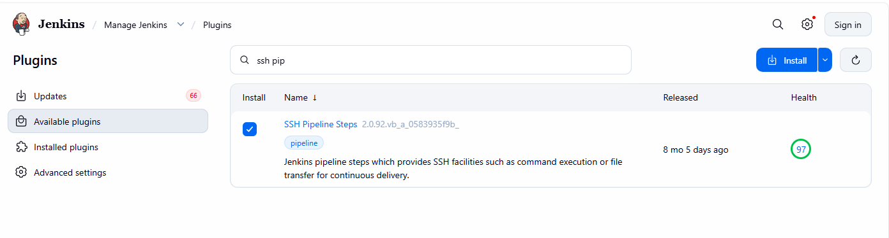
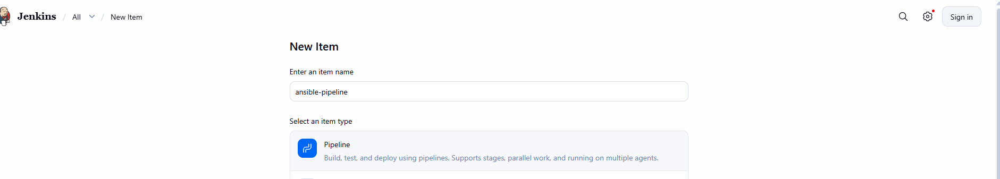
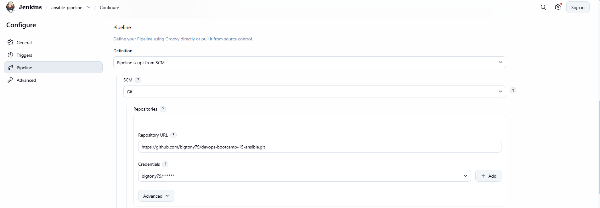
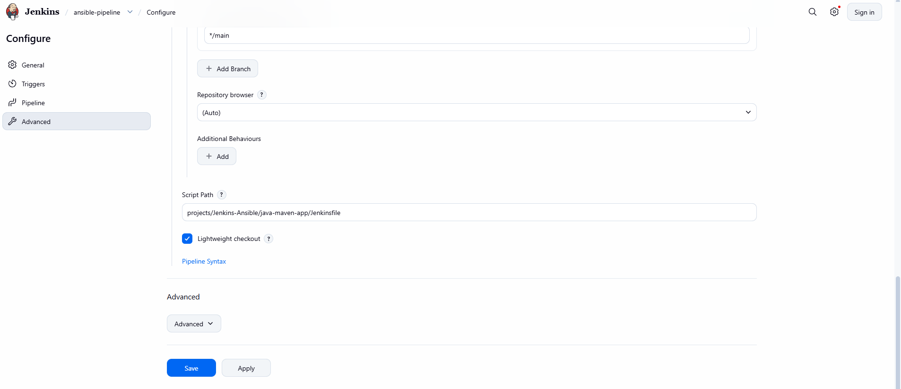
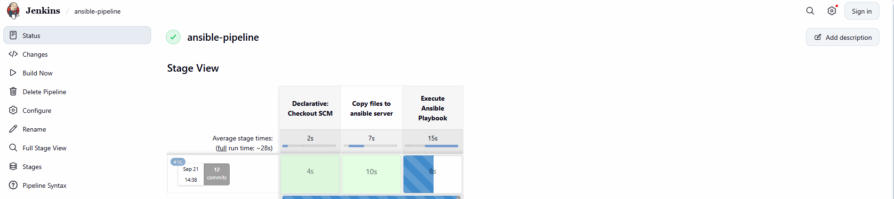
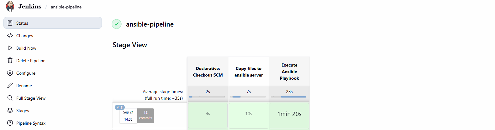

# Ansible integration with Jenkins

## Overview

This project demonstrates how to integrate Jenkins and Ansible to automate server configuration as part of a CI/CD pipeline. Jenkins acts as the orchestration platform and remotely executes Ansible playbooks on a dedicated Ansible Control Node, which in turn manages multiple AWS EC2 instances. 

The objective is to build an end-to-end automation workflow where infrastructure and configuration tasks can be executed directly from a Jenkins pipeline. The pipeline securely transfers playbooks, configuration files, and SSH credentials to the Ansible Control Node, installs required dependencies, and executes Ansible playbooks that configure and manage target EC2 instances.

## Technologies used
* Ansible
* Jenkins
* DigitalOcean
* AWS
* Boto3
* Docker
* Java
* Maven
* Linux
* Git

## Project Description
* Create and configure a dedicated server for Ansible Control Node
* Write Ansible Playbook, which configures 2 EC2 Instances
* Add ssh key file credentials in Jenkins for Ansible Control Node server and Ansible Managed Node servers
* Configure Jenkins to execute the Ansible Playbook on remote Ansible Control Node server as part of the CI/CD pipeline
* So the Jenkinsfile configuration will do the following:
  - Connect to the remote Ansible Control Node server
  - Copy Ansible playbook and configuration files to the remote Ansible Control Node server
  - Copy the ssh keys for the Ansible Managed Node servers to the Ansible Control Node server
  - Install Ansible, Python3 and Boto3 on the Ansible Control Node server
  - With everything installed and copied to the remote Ansible Control Node server, execute the playbook remotely on that Control Node that will configure the 2 EC2 Managed Nodes

## Architecture
 
```text
+------------+
| Jenkins    |
+------+-----+
       |
       | SSH
       v
+--------------+
| Ansible      |
| Control Node |
+------+-------+
      |
      | Ansible
      |
 +----+----+
 |         |
 v         v
+------+ +------+
| EC2 | | EC2 |
|Node1 | |Node2 |
+------+ +------+
```

Workflow:
* Jenkins checks out code from Git.
* Jenkins copies playbooks and credentials to the Ansible Control Node.
* Jenkins remotely executes the Ansible playbook.
* Ansible connects to and configures the EC2 instances.

## Prerequisites
Before starting this lab, ensure you have the following:
 
- Jenkins installed and operational
- DigitalOcean account
- AWS account with permissions to create and manage EC2 resources
- Terraform installed
- SSH key pairs for:
  - Jenkins → Ansible Control Node access
  - Ansible Control Node → EC2 Managed Nodes access
- Git repository containing the Ansible playbooks and Jenkinsfile
- Basic familiarity with Jenkins Pipelines and Ansible

### Jenkins Requirements

Install the following Jenkins plugins:
 
- SSH Agent Plugin - Jenkins uses the SSH Agent Plugin to securely inject SSH credentials into pipeline jobs
  

- SSH Pipeline Steps Plugin - Allows Jenkins to execute commands on remote servers, enabling Jenkins to securely connect to an Ansible Control Node and run Ansible playbooks without exposing private keys in the pipeline code.
- Git Plugin
- Pipeline Plugin
 
### Ansible Control Node Requirements
 
The Ansible Control Node should have the following software installed:
 
- Ansible
- Python 3
- boto3
- botocore
- AWS CLI

Verify the installations:
 
```
  ansible --version
  python3 --version
  aws --version
```
### AWS Credentials Configuration
 
Configure AWS credentials on the Ansible Control Node:
 
```bash
mkdir -p ~/.aws
vim ~/.aws/credentials
```
 
Add the AWS access key and secret key for a user with permissions to manage EC2 resources.
 
### Jenkins Credentials Configuration
 
Store the following credentials in Jenkins:
 
- SSH private key for Ansible Control Node access
- SSH private key for EC2 Managed Nodes access
- Any AWS credentials required by the pipeline
 
Navigate to:
 
```text
Manage Jenkins → Credentials → System → Global Credentials
```
 
and create the appropriate credential entries before executing the pipeline.


## Steps

### 1. Create 2 EC2 Instances to be managed by Ansible
Create a terraform variables .tvars file and define the key value pairs
```
  vpc_cidr_block = <VPC_MAIN_CIDR_BLOCK>
  subnet_cidr_block = <SUBNET_CIDR_BLOCK>
  avail_zone = <AVAILABILITY_ZONE>
  env_prefix = <ENVIRONMENT_PREFIX>
  my_ip = <ANSIBLE_SERVER_IP_ADDRESS>
  instance_type = <DESIRED_INSTANCE_TYPE>
  public_key_location = <PUBLIC_KEY_LOCATION>
  image_name = "al2023-ami-2023*"
```
Run terraform to create the 2 EC2 Instances:
```
  terraform init
  terraform plan
  terraform apply
```


### 2. JenkinsFile: Copy files from Jenkins to Ansible Control Node
a. Create Jenkins Pipeline - We will set the script path to **projects/Jenkins/java-maven-app/Jenkinsfile**







b. Run the pipeline





### 3. Check the Console ouptut for details of the successful/failed run

```
....

[Pipeline] { (Execute Ansible Playbook)
[Pipeline] script
[Pipeline] {
[Pipeline] echo
Executing Ansible Playbook to configure EC2 Instances
[Pipeline] withCredentials
Masking supported pattern matches of $keyFile
[Pipeline] {
[Pipeline] sshCommand
Executing command on ansible-server[159.89.54.64]: ansible-playbook deploy_docker_tf_hosts.yaml sudo: false

PLAY [Install Docker and Docker Compose] ***************************************

TASK [Gathering Facts] *********************************************************
[WARNING]: Platform linux on host ec2-54-84-104-33.compute-1.amazonaws.com is
using the discovered Python interpreter at /usr/bin/python3.9, but future
installation of another Python interpreter could change the meaning of that
path. See https://docs.ansible.com/ansible-
core/2.16/reference_appendices/interpreter_discovery.html for more information.
[WARNING]: Platform linux on host ec2-18-207-174-156.compute-1.amazonaws.com is
using the discovered Python interpreter at /usr/bin/python3.9, but future
installation of another Python interpreter could change the meaning of that
path. See https://docs.ansible.com/ansible-
core/2.16/reference_appendices/interpreter_discovery.html for more information.
ok: [ec2-54-84-104-33.compute-1.amazonaws.com]
ok: [ec2-18-207-174-156.compute-1.amazonaws.com]

TASK [Install Docker] **********************************************************
changed: [ec2-54-84-104-33.compute-1.amazonaws.com]
changed: [ec2-18-207-174-156.compute-1.amazonaws.com]

TASK [Start and enable Docker service] *****************************************
changed: [ec2-54-84-104-33.compute-1.amazonaws.com]
changed: [ec2-18-207-174-156.compute-1.amazonaws.com]

PLAY [Download and Install Docker Compose] *************************************

TASK [Gathering Facts] *********************************************************
ok: [ec2-54-84-104-33.compute-1.amazonaws.com]
ok: [ec2-18-207-174-156.compute-1.amazonaws.com]

TASK [Create directory for docker-compose] *************************************
changed: [ec2-54-84-104-33.compute-1.amazonaws.com]
changed: [ec2-18-207-174-156.compute-1.amazonaws.com]

TASK [Get architecture of remote host] *****************************************
changed: [ec2-54-84-104-33.compute-1.amazonaws.com]
changed: [ec2-18-207-174-156.compute-1.amazonaws.com]

TASK [Download docker-compose] *************************************************
changed: [ec2-18-207-174-156.compute-1.amazonaws.com]
changed: [ec2-54-84-104-33.compute-1.amazonaws.com]

TASK [Verify docker-compose installation] **************************************
changed: [ec2-54-84-104-33.compute-1.amazonaws.com]
changed: [ec2-18-207-174-156.compute-1.amazonaws.com]

TASK [Display docker-compose version] ******************************************
ok: [ec2-54-84-104-33.compute-1.amazonaws.com] => {
    "msg": "Docker Compose version installed: Docker Compose version v5.5.0"
}
ok: [ec2-18-207-174-156.compute-1.amazonaws.com] => {
    "msg": "Docker Compose version installed: Docker Compose version v5.5.0"
}

PLAY RECAP *********************************************************************
ec2-18-207-174-156.compute-1.amazonaws.com : ok=9    changed=6    unreachable=0    failed=0    skipped=0    rescued=0    ignored=0   
ec2-54-84-104-33.compute-1.amazonaws.com : ok=9    changed=6    unreachable=0    failed=0    skipped=0    rescued=0    ignored=0   

....

Finished: SUCCESS
```

### 4. Destroy the AWS Infrastructue

Run ```terraform destroy``` to destroy all AWS infrastructure to avoid additional costs.

## Learning Outcomes

- Integrate Ansible into Jenkins pipelines 
- Configure a dedicated Ansible Control Node 
- Manage AWS EC2 instances with Ansible 
- Securely store and use SSH credentials in Jenkins 
- Execute remote commands through Jenkins 
- Automate server configuration as part of a CI/CD workflow 
- Build scalable infrastructure automation solutions


